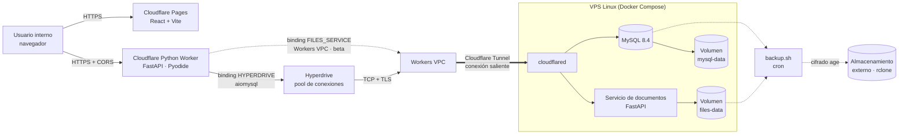

# Arquitectura de APHIA

Modelo de datos (32 tablas en 3FN, relaciones y decisiones pendientes):
[modelo-de-datos.md](modelo-de-datos.md).

## Diagrama de componentes



La línea punteada entre el Worker y el servicio de documentos indica una integración
**preparada pero no implementada** en esta fase (ver «Documentos»).

## Comunicación entre servicios

| Origen → destino | Protocolo | Autenticación | Estado |
| --- | --- | --- | --- |
| Navegador → Pages | HTTPS | — | Configurado (`_redirects`, `_headers`) |
| Navegador → API | HTTPS, JSON, CORS con orígenes explícitos | Token de sesión `Authorization: Bearer` (HMAC, 8 h) tras login con contraseña | Funcional |
| API → MySQL (Workers) | aiomysql → binding Hyperdrive → Workers VPC → túnel | Usuario `aphia_app` (solo DML), TLS | Local verificado; producción preparada |
| API → MySQL (Uvicorn) | aiomysql directo | Igual | Verificado localmente |
| API → documentos | HTTP vía binding Workers VPC (`env.FILES_SERVICE`) | `Authorization: Bearer <token de servicio>` | Preparado; adaptador pendiente |
| Respaldos → externo | rclone | Clave pública `age` | Preparado; no ejecutado |

## Estructura de la API

```text
src/main.py            create_app(): FastAPI ASGI puro (Uvicorn y Workers)
src/entry.py           Default = asgi.entrypoint(app)  ← único import de `workers`
src/core/              config, errores, logging JSON, middleware (request id, cabeceras, CORS)
src/db/                DatabaseConfig, Database (conexión por operación), dependencia FastAPI
src/integrations/      cloudflare.py: lee env y binding Hyperdrive desde scope["env"]
src/modules/<dominio>  router → service → repository (+ schemas Pydantic)
```

Flujo de una solicitud:

1. `RequestContextMiddleware` resuelve la configuración: en Workers desde `scope["env"]`
   (variables de `wrangler.jsonc` y secretos); en Uvicorn desde variables de entorno.
2. `SettingsCORSMiddleware` aplica CORS con los orígenes de ese entorno.
3. El router valida con Pydantic, verifica roles y llama al servicio.
4. El repositorio obtiene `Database` de `get_database`: en Workers usa los parámetros del
   binding Hyperdrive; en Uvicorn, `DB_*`.

## Flujo de autenticación

1. `POST /api/v1/auth/login` recibe usuario y contraseña; el repositorio lee `user_account`
   (con `GROUP_CONCAT` de roles) y el servicio verifica el hash PBKDF2-HMAC-SHA256 en tiempo
   constante (hash ficticio si el usuario no existe).
2. Tres fallos seguidos fijan `locked_until = ahora + 15 min` (423 `cuenta_bloqueada`); un
   inicio correcto reinicia el contador.
3. La API emite un token firmado con HMAC-SHA256 (`AUTH_SECRET`), válido 8 h, con sujeto,
   nombre y roles; la web lo guarda en `sessionStorage` (o `localStorage` con «Recordarme») y
   lo envía como `Authorization: Bearer`.
4. `get_current_principal` verifica firma y vigencia en cada solicitud; `require_roles`
   aplica los grupos de roles por router. Un 401 en la web limpia la sesión y vuelve a `/login`.

## Justificación de tecnologías

| Decisión | Motivo |
| --- | --- |
| Cloudflare Pages + Workers | Costo prácticamente nulo con poco tráfico, HTTPS y CDN incluidos, sin servidores web que mantener. |
| Python Workers + FastAPI | FastAPI tiene soporte oficial en Python Workers; validación con Pydantic; ASGI permite el plan B con Uvicorn. |
| aiomysql | Controlador MySQL recomendado por la documentación de Hyperdrive para Python; puro Python (compatible con Pyodide). |
| Sin ORM | SQLAlchemy asíncrono no funciona en Python Workers (requiere greenlet). SQL parametrizado explícito es suficiente para el volumen de APHIA. |
| Hyperdrive | Mantiene el pool de conexiones a MySQL cerca del Worker; el Worker abre una conexión por solicitud sin penalizar a MySQL. |
| MySQL 8.4 LTS en VPS | Requisito del proyecto; soporte extendido; el VPS también aloja documentos. |
| Documentos en disco (no en MySQL) | Respaldos y base de datos livianos; el servicio controla acceso, tipo y tamaño. |
| Cloudflare Tunnel + Workers VPC | MySQL y documentos sin puertos abiertos a Internet: el túnel es una conexión saliente desde el VPS. |
| pnpm + uv | Instalación rápida y reproducible con lockfiles para JS y Python. |
| Scripts Node en lugar de Makefile | Funcionan igual en Windows 11 y Linux. |

## Separación entre entornos

| Aspecto | development (local) | test (CI/integración) | staging | production |
| --- | --- | --- | --- | --- |
| API | `pywrangler dev` o Uvicorn | ASGI en pytest / Worker local en E2E | Worker `aphia-api-staging` | Worker `aphia-api` |
| MySQL | Docker `127.0.0.1:3307`, base `aphia` | Contenedor aparte `:3308`, base `aphia_test`, en memoria | Base y Hyperdrive propios (por definir) | VPS, Hyperdrive de producción |
| Conexión a MySQL | Hyperdrive local (`localConnectionString` por variable) — sin pool ni caché | Directa | Hyperdrive + Workers VPC | Hyperdrive + Workers VPC |
| Autenticación | Login real (`AUTH_MODE=database`, usuarios de `pnpm db:seed`) | Ficticia en unitarias; real en E2E | Login real (`AUTH_SECRET` por `wrangler secret`) | Igual |
| CORS | `localhost:5173` | `localhost:5173` | URL de Pages de staging | URL de Pages de producción |
| Secretos | `.env` generado | Valores efímeros de CI | `wrangler secret`, GitHub Environment | Igual, con aprobación obligatoria |
| HSTS / docs OpenAPI | Sin HSTS / `/api/docs` visible | Igual | HSTS / docs ocultas | HSTS / docs ocultas |

El nombre del Worker local es `aphia-api-local` y su id de Hyperdrive es un marcador: un
`deploy` sin `--env` falla en lugar de publicar la configuración de desarrollo.

## Estrategia de portabilidad

- `main.py` es una aplicación ASGI estándar; `entry.py` (3 líneas) es lo único específico de
  Workers. Verificado: la misma app responde con `runtime: "workers"` y `runtime: "asgi"`.
- La configuración entra por una función `get(nombre)`: `os.environ` o el `env` de Workers.
- `integrations/cloudflare.py` aísla bindings; los módulos de negocio no lo importan.
- La lógica de negocio depende de protocolos (`ClientesRepositoryPort`, `DocumentStorage`),
  no de Cloudflare.
- Migrar fuera de Cloudflare: ejecutar `uvicorn main:app --app-dir src` detrás de un proxy TLS en
  el VPS (o en otro servidor), definir `DB_*` y servir `apps/web/dist` como sitio estático.

## Compatibilidad con Cloudflare Python Workers (validación realizada)

Documentación consultada el 2026-10-27 (Python Workers, FastAPI, Hyperdrive + Python,
desarrollo local, conexión privada, Workers VPC). Resultados **verificados en este equipo**:

| Verificación | Resultado |
| --- | --- |
| FastAPI con `asgi.entrypoint(app)` en `pywrangler dev` (pywrangler 1.17.9, wrangler 4.153, workerd 1.20261023.1) | ✅ |
| aiomysql dentro de Pyodide conectando por el binding Hyperdrive local a MySQL 8.4 en Docker | ✅ lectura, escritura, restricción única (409) |
| Pydantic v2 (validación, errores 422) dentro del Worker | ✅ |
| Middleware ASGI propio, CORS y cabeceras de seguridad dentro del Worker | ✅ |
| `pywrangler deploy --dry-run` (local, staging, production) | ✅ 9,8 MB sin comprimir / 2,45 MB gzip |
| Binding `vpc_services` reconocido por wrangler | ✅ (solo validación de configuración) |

Versiones de Python: con `compatibility_date = 2026-10-27`, pywrangler resolvió el paquete
del Worker para **Python ≥ 3.14.2** (Pyodide), según `apps/api/pylock.toml`. El desarrollo
local, las pruebas y Uvicorn usan **Python 3.13**. Las versiones de las dependencias son las
mismas en ambos lockfiles (FastAPI 0.162.0, Pydantic 2.14.1, aiomysql 0.3.2) y el código
se verificó en los dos runtimes. Al cambiar `compatibility_date`, revise `pylock.toml`.

| Lockfile | Qué fija |
| --- | --- |
| `pnpm-lock.yaml` | Dependencias JS (incluye wrangler y workerd) |
| `apps/api/uv.lock` | Dependencias Python de desarrollo, pruebas y Uvicorn |
| `apps/api/pylock.toml` | Paquetes empaquetados en el Worker (lo regenera `pywrangler sync`) |
| `apps/files/uv.lock` | Servicio de documentos |

Limitaciones y diferencias conocidas:

- **Desarrollo local sin pool:** con la cadena local, Hyperdrive conecta directo a MySQL sin
  pool ni caché (documentado por Cloudflare). En producción sí hay pool.
- **Arranque en frío local:** la primera solicitud a `pywrangler dev` tarda ~9 s (carga de
  Pyodide). En producción Cloudflare usa *snapshots* de memoria; no se midió.
- **Sockets:** no pueden crearse en el ámbito global del módulo; por eso la conexión es por operación.
- **Tamaño del Worker:** 2,45 MB comprimido. Verifique el límite vigente de su plan en
  la documentación de límites de Workers antes de agregar dependencias pesadas.
- **Workers VPC está en beta.** La documentación muestra su uso desde JavaScript; el uso del
  binding `FILES_SERVICE` desde Python **no está confirmado** por la documentación. Si no
  funciona, la alternativa sin cambiar la lógica es un adaptador HTTP hacia un hostname
  publicado por el túnel y protegido con Cloudflare Access (token de servicio) además del
  token propio del servicio de documentos.
- **TLS Hyperdrive → MySQL:** Hyperdrive exige TLS. MySQL usa un certificado autofirmado y
  Workers VPC aún no permite subir una CA propia; ver `docs/despliegue/tunnel-y-acceso-privado.md`.

## Documentos

- El servicio `apps/files` almacena cada archivo como `<id>.bin` + `<id>.json` en un volumen
  persistente; el id es un UUID4 generado por el servicio (nunca el nombre del usuario).
- Valida tipo por firma binaria (PDF, PNG, JPEG configurables), tamaño máximo, y rechaza
  ids que no sean 32 caracteres hexadecimales (sin *path traversal*).
- Escritura exclusiva (`xb`): nunca sobrescribe; metadatos escritos de forma atómica.
- Siguiente fase: tabla `documentos` en MySQL (id, file_id, entidad relacionada, tipo,
  tamaño, sha256, usuario, fechas) y endpoints en la API que validen permisos y llamen al
  servicio mediante `modules/documentos/ports.py::DocumentStorage`.
