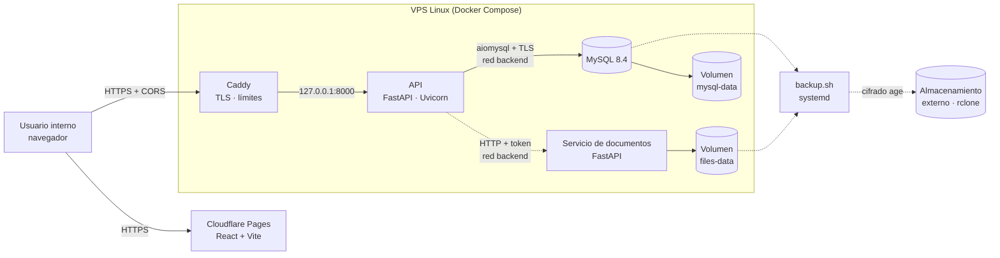

# Arquitectura de APHIA

Modelo de datos (32 tablas en 3FN, relaciones y decisiones pendientes):
[modelo-de-datos.md](modelo-de-datos.md).

## Despliegue

El frontend (React + Vite) se publica en **Cloudflare Pages**. Todo el lado servidor corre en
un **VPS Linux** con Docker Compose: la API (FastAPI con Uvicorn), MySQL 8.4 y el servicio de
documentos comparten la red interna `backend`, sin puertos públicos. La API solo escucha en
`127.0.0.1:8000` y **Caddy** (instalado en el host) la publica por HTTPS en
`api.aphia.com.co`, con certificado de Let's Encrypt, límite de tamaño de cuerpo y límite de
peticiones por IP. La API conecta a MySQL con TLS (`DB_SSL_MODE=required`) y lee los secretos
desde archivos (`*_FILE`, Docker secrets).



La línea punteada entre la API y el servicio de documentos indica una integración
**preparada pero no implementada** en esta fase (ver «Documentos»).

## Comunicación entre servicios

| Origen → destino | Protocolo | Autenticación | Estado |
| --- | --- | --- | --- |
| Navegador → Pages | HTTPS | — | En producción (`_redirects`, `_headers`) |
| Navegador → API | HTTPS (Caddy), JSON, CORS con orígenes explícitos | Token de sesión `Authorization: Bearer` (HMAC, 8 h por defecto, revocable) tras login con contraseña | En producción |
| API → MySQL | aiomysql por la red interna `backend` | Usuario `aphia_app` (solo DML), TLS | En producción |
| API → documentos | HTTP por la red interna `backend` (`FILES_SERVICE_URL`) | `Authorization: Bearer <token de servicio>` | Preparado; adaptador pendiente |
| Respaldos → externo | rclone | Clave pública `age` | En producción (semanal) |

## Estructura de la API

```text
src/main.py            create_app(): aplicación FastAPI (Uvicorn: main:app)
src/core/              config, errores, logging JSON, middleware (request id, cabeceras, CORS)
src/db/                DatabaseConfig, Database (conexión por operación), dependencia FastAPI
src/modules/<dominio>  router → service → repository (+ schemas Pydantic)
```

Flujo de una solicitud:

1. `RequestContextMiddleware` deja en la solicitud la configuración leída de las variables de
   entorno y los Docker secrets (`core/runtime.py`, una sola lectura por proceso).
2. `SettingsCORSMiddleware` aplica CORS con los orígenes de ese entorno.
3. El router valida con Pydantic, verifica roles y llama al servicio.
4. El repositorio obtiene `Database` de `get_database`, con los parámetros `DB_*`.

## Flujo de autenticación

1. `POST /api/v1/auth/login` recibe usuario y contraseña; el repositorio lee `user_account`
   (con `GROUP_CONCAT` de roles) y el servicio verifica el hash PBKDF2-HMAC-SHA256 en tiempo
   constante (hash ficticio si el usuario no existe).
2. Los fallos seguidos que fija la política (`security_policy`, 3 por defecto) bloquean la
   cuenta los minutos configurados (15 por defecto; 423 `cuenta_bloqueada`); un inicio
   correcto reinicia el contador.
3. La API emite un token firmado con HMAC-SHA256 (`AUTH_SECRET`) con sujeto, nombre, roles,
   vencimiento (8 h por defecto) y `ver` (`session_version` de la cuenta); la web lo guarda en
   `sessionStorage` (o `localStorage` con «Recordarme») y lo envía como `Authorization: Bearer`.
4. `get_current_principal` verifica firma y vigencia y compara `ver` con MySQL en cada
   solicitud (una consulta por clave primaria): cerrar sesiones, restablecer o cambiar la clave,
   cambiar el rol o desactivar la cuenta invalidan el token al instante. Con una clave temporal
   solo se permiten `/auth/me` y `/auth/cambiar-clave`. `require_roles` aplica los grupos de
   roles por router. Un 401 en la web limpia la sesión y vuelve a `/login`.
5. Cada escritura queda en `audit_event` (actor, acción, registro, `request_id`) y cada
   eliminación de personas, inmuebles o contratos deja una instantánea en `deleted_record`.

## Justificación de tecnologías

| Decisión | Motivo |
| --- | --- |
| Cloudflare Pages (frontend) | Costo prácticamente nulo, HTTPS y CDN incluidos, build automático en cada push a `main`. |
| API en VPS con Uvicorn (Docker) | Control de CPU y memoria: el login deriva contraseñas con PBKDF2, que superaba el límite de CPU de Cloudflare Workers (alternativa evaluada y descartada). Un único servidor aloja API, MySQL y documentos. |
| Caddy en el host | HTTPS automático (Let's Encrypt), proxy inverso y límites de cuerpo y de peticiones por IP sin configuración compleja. |
| FastAPI | Validación con Pydantic, tipado y documentación OpenAPI local. |
| aiomysql | Controlador MySQL asíncrono, compatible con el bucle de eventos de FastAPI. |
| Sin ORM | SQL parametrizado explícito es suficiente para el volumen de APHIA y deja ver cada consulta. |
| MySQL 8.4 LTS en VPS | Requisito del proyecto; soporte extendido. |
| Documentos en disco (no en MySQL) | Respaldos y base de datos livianos; el servicio controla acceso, tipo y tamaño. |
| Red interna de Docker | MySQL y documentos sin puertos publicados: solo la API los alcanza. |
| pnpm + uv | Instalación rápida y reproducible con lockfiles para JS y Python. |
| Scripts Node en lugar de Makefile | Funcionan igual en Windows 11 y Linux. |

| Lockfile | Qué fija |
| --- | --- |
| `pnpm-lock.yaml` | Dependencias JS (frontend, Playwright, scripts) |
| `apps/api/uv.lock` | Dependencias Python de la API (ejecución, desarrollo y pruebas) |
| `apps/files/uv.lock` | Servicio de documentos |

## Separación entre entornos

| Aspecto | development (local) | test (CI/integración) | production |
| --- | --- | --- | --- |
| API | Uvicorn `127.0.0.1:8000` (`pnpm dev`) | ASGI en pytest; Uvicorn en E2E | Uvicorn en Docker en el VPS, detrás de Caddy |
| MySQL | Docker `127.0.0.1:3307`, base `aphia` | Contenedor aparte `:3308`, base `aphia_test`, en memoria | Contenedor en la red interna `backend`, con TLS |
| Autenticación | Login real (`AUTH_MODE=database`, usuarios de `pnpm db:seed`) | Ficticia en unitarias; real en E2E | Login real |
| CORS | `localhost:5173` | `localhost:5173` | `https://app.aphia.com.co` |
| Secretos | `.env` generado | Valores efímeros de CI | Docker secrets en `infra/production/secrets/`, GitHub Environment para el despliegue |
| HSTS / docs OpenAPI | Sin HSTS / `/api/docs` visible | Igual | HSTS / docs ocultas |

## Documentos

- El servicio `apps/files` almacena cada archivo como `<id>.bin` + `<id>.json` en un volumen
  persistente; el id es un UUID4 generado por el servicio (nunca el nombre del usuario).
- Valida tipo por firma binaria (PDF, PNG, JPEG configurables), tamaño máximo, y rechaza
  ids que no sean 32 caracteres hexadecimales (sin *path traversal*).
- Escritura exclusiva (`xb`): nunca sobrescribe; metadatos escritos de forma atómica.
- Siguiente fase: tabla `documentos` en MySQL (id, file_id, entidad relacionada, tipo,
  tamaño, sha256, usuario, fechas) y endpoints en la API que validen permisos y llamen al
  servicio mediante `modules/documentos/ports.py::DocumentStorage`.
