# Modelo de datos (3FN)

## Origen

El esquema proviene del modelo entidad–relación revisado y normalizado a 3FN del proyecto de
grado (`outputs/modelo-bd-3fn/esquema-referencia-mysql.sql` y `analisis-y-trazabilidad.md`,
21 de octubre de 2026). Ese análisis reubica los 52 campos visibles de las 8 tablas
originales en **32 tablas, 120 columnas, 36 claves foráneas, 7 restricciones CHECK y 3
índices de consulta**.

En el repositorio el DDL se aplica como migraciones `0002`–`0007`. Las sentencias se
copiaron **sin cambios** y se verificó que coinciden una a una con el archivo de referencia.

| Migración | Contenido |
| --- | --- |
| `0002_modelo_catalogos` | 15 catálogos |
| `0003_modelo_personas_y_cuentas` | `person`, documentos, teléfonos, correos, cuentas de acceso, roles, cuentas bancarias |
| `0004_modelo_inmuebles` | `property`, propietarios, servicios públicos |
| `0005_modelo_acuerdos_y_finanzas` | Acuerdos, participantes, registros financieros |
| `0006_modelo_archivos` | Metadatos de archivos y sus vínculos |
| `0007_modelo_indices_consulta` | Índices por acuerdo/fecha, inmueble/fechas y persona |

La migración `0001_crear_clientes` es la tabla de **demostración** de la fase anterior (ver
«Tabla `clientes` de demostración»).

## Diagrama de relaciones

```mermaid
erDiagram
    person_category |o--o{ person : clasifica
    person ||--o{ person_document : identifica
    document_type ||--o{ person_document : tipo
    person ||--o{ person_phone : contacto
    person ||--o{ person_email : contacto
    person ||--o{ user_account : accede
    user_account ||--o{ user_role : tiene
    app_role ||--o{ user_role : asigna
    person ||--o{ bank_account : titular
    bank_account_category ||--o{ bank_account : tipo
    financial_institution ||--o{ bank_account : entidad

    city |o--o{ property : ubica
    currency |o--o{ property : canon
    occupancy_state |o--o{ property : estado
    property ||--o{ property_owner : pertenece
    person ||--o{ property_owner : propietario
    property ||--o{ property_utility : servicio
    utility_type |o--o{ property_utility : tipo
    service_provider |o--o{ property_utility : proveedor

    agreement_category ||--o{ property_agreement : categoria
    property ||--o{ property_agreement : acuerdo
    currency |o--o{ property_agreement : canon_pactado
    property_agreement ||--o{ agreement_party : participa
    person ||--o{ agreement_party : participante
    party_role ||--o{ agreement_party : rol
    property_agreement ||--o{ financial_record : registra
    financial_category ||--o{ financial_record : categoria
    payment_state ||--o{ financial_record : estado
    currency ||--o{ financial_record : moneda

    file_category ||--o{ file_record : categoria
    file_record ||--o{ file_person : vincula
    person ||--o{ file_person : soporte
    file_record ||--o{ file_property : vincula
    property ||--o{ file_property : soporte
    file_record ||--o{ file_agreement : vincula
    property_agreement ||--o{ file_agreement : anexo
```

Las 36 relaciones usan `ON DELETE RESTRICT ON UPDATE RESTRICT`: no se borra ni se cambia el
identificador de un registro referenciado.

## Correspondencia con los módulos de la aplicación

| Módulo de APHIA | Tablas |
| --- | --- |
| Clientes y propietarios | `person` (+ `person_category`, `person_document`, `person_phone`, `person_email`). Ser propietario es un vínculo (`property_owner`), no un tipo de persona |
| Inmuebles | `property`, `property_owner`, `property_utility`, `city`, `occupancy_state` |
| Contratos | `property_agreement`, `agreement_party` (roles `ASSOCIATED`, `CO_DEBTOR`, …), `agreement_category` |
| Finanzas | `financial_record`, `financial_category`, `payment_state`, `currency`, `bank_account` |
| Documentos | `file_record` + `file_person`, `file_property`, `file_agreement` |
| Usuarios y permisos | `user_account`, `app_role`, `user_role` |

### Documentos y el servicio de archivos

Propuesta para los archivos nuevos (por confirmar al implementar el módulo):

- `file_record.file_path` guarda la referencia al servicio privado (`files:<id>`, donde
  `<id>` es el UUID que devuelve `apps/files`), nunca una URL pública ni una ruta del disco.
- `sha256` (`BINARY(32)`), `size_bytes` y `mime_type` se llenan con los metadatos verificados
  que devuelve el servicio (el servicio entrega el hash en hexadecimal: `UNHEX(...)`).
- Los archivos migrados conservan su `file_path` original.

### Autenticación

`user_account.hashed_password` es obligatorio y el análisis pide conservar los hashes
originales. Si se adopta un proveedor de identidad externo (por ejemplo Cloudflare Access),
habrá que decidir cómo convive con esa columna y hacerlo con una migración nueva.

## Reglas físicas

- Claves `BIGINT` **con signo** (compatibles con identificadores `INT` originales).
- Colación `utf8mb4_0900_bin`: las comparaciones y los índices distinguen mayúsculas y
  acentos. El inicio de sesión por `user_name` distingue mayúsculas (probado). Para búsquedas
  por nombre sin distinguirlas, agregue columnas normalizadas con su propio índice.
- Importes `DECIMAL(12,2)` con moneda explícita. Documentos, teléfonos y números bancarios se
  guardan como texto (se conservan los ceros iniciales).
- Fechas de operación en UTC (la API fija `time_zone = '+00:00'` en cada conexión).

## Verificación automática

`apps/api/tests/integration/test_modelo_3fn.py` (se ejecuta con `pnpm test:integration` sobre
una base vacía, aplicando todas las migraciones) comprueba:

- Que existen las 32 tablas con colación binaria y las 36 claves foráneas con `RESTRICT`.
- Escenarios aceptados: copropiedad, varios codeudores, una persona en varios acuerdos y
  roles, un archivo con tres tipos de vínculo, documento con ceros iniciales y movimiento negativo.
- Rechazos: FK huérfana (1452), participante duplicado (1062), documento duplicado entre
  personas (1062), fechas invertidas, canon negativo, canon sin moneda y tamaño negativo
  (3819), borrado con referencias (1451), usuario duplicado (1062).

## Tabla `clientes` de demostración

`clientes` (migración `0001`) sostiene el flujo mínimo que valida la arquitectura (API,
frontend y E2E). **No forma parte del modelo.** Al implementar el módulo de clientes sobre
`person`:

1. Cambiar el repositorio de `modules/clientes` para usar `person` + `person_email`.
2. Ajustar las pruebas y el frontend.
3. En una versión posterior, eliminar la tabla con una migración nueva (`DROP TABLE clientes`).

## Datos de catálogos

Las migraciones crean los catálogos **vacíos**. Según el plan de migración, sus valores deben
cargarse a partir de los valores reales distintos de la fuente original, sin traducir ni
fusionar automáticamente. Los datos ficticios para desarrollo se agregarán en `database/seeds/`
cuando se implementen los módulos.

## Decisiones de negocio pendientes antes de producción

Resumen del análisis original (el detalle está en `analisis-y-trazabilidad.md`):

1. **Identidad:** ámbito emisor de cada tipo documental y conciliación de personas y usuarios
   sin fusionar por nombre, correo o número.
2. **Personas y roles:** significado de `person_category`, personas jurídicas, qué rol
   corresponde a `ASSOCIATED` e incompatibilidades entre roles.
3. **Inmuebles:** ámbito de la matrícula (`registration_identifier` no es único) y unicidad de ciudades.
4. **Histórico:** períodos de titularidad, versiones, adendas y bloqueo de acuerdos firmados.
5. **Contratos simultáneos:** qué tipos de acuerdo se excluyen. Exige una transacción que
   bloquee el inmueble; un `CHECK` no evita dobles arriendos concurrentes.
6. **Finanzas:** qué representa cada `financial_record` (cargo, pago, gasto…); pagos parciales,
   saldos y reversos requieren un submodelo adicional.
7. **Importes:** moneda, precisión y escala (`DECIMAL(12,2)`); no suponer COP en datos históricos.
8. **Banca:** unicidad por institución y tipo, cuentas conjuntas y cifrado.
9. **Archivos:** permisos de descarga, límites y tipos (ver la propuesta de integración arriba).
10. **Operación y acceso:** permisos reales por rol, auditoría con actor y fecha, formato de
    los hashes de contraseña heredados.

Mientras estas decisiones estén abiertas, cualquier cambio al esquema se hace con migraciones
nuevas (nunca editando `0002`–`0007`).
