# Modelo de datos (3FN)

## Origen

El esquema proviene del modelo entidad–relación revisado y normalizado a 3FN del proyecto de
grado (`outputs/modelo-bd-3fn/esquema-referencia-mysql.sql` y `analisis-y-trazabilidad.md`,
21 de octubre de 2026). Ese análisis reubica los 52 campos visibles de las 8 tablas
originales en **32 tablas, 120 columnas, 36 claves foráneas, 7 restricciones CHECK y 3
índices de consulta**.

En el repositorio el DDL se aplica como migraciones `0002`–`0007`. Las sentencias se
copiaron **sin cambios** y se verificó que coinciden una a una con el archivo de referencia.

| Migración | Contenido |
| --- | --- |
| `0002_modelo_catalogos` | 15 catálogos |
| `0003_modelo_personas_y_cuentas` | `person`, documentos, teléfonos, correos, cuentas de acceso, roles, cuentas bancarias |
| `0004_modelo_inmuebles` | `property`, propietarios, servicios públicos |
| `0005_modelo_acuerdos_y_finanzas` | Acuerdos, participantes, registros financieros |
| `0006_modelo_archivos` | Metadatos de archivos y sus vínculos |
| `0007_modelo_indices_consulta` | Índices por acuerdo/fecha, inmueble/fechas y persona |

La migración `0001_crear_clientes` es la tabla de **demostración** de la fase anterior (ver
«Tabla `clientes` de demostración»).

## Diagrama de relaciones

```mermaid
erDiagram
    person_category |o--o{ person : clasifica
    person ||--o{ person_document : identifica
    document_type ||--o{ person_document : tipo
    person ||--o{ person_phone : contacto
    person ||--o{ person_email : contacto
    person ||--o{ user_account : accede
    user_account ||--o{ user_role : tiene
    app_role ||--o{ user_role : asigna
    person ||--o{ bank_account : titular
    bank_account_category ||--o{ bank_account : tipo
    financial_institution ||--o{ bank_account : entidad

    city |o--o{ property : ubica
    currency |o--o{ property : canon
    occupancy_state |o--o{ property : estado
    property ||--o{ property_owner : pertenece
    person ||--o{ property_owner : propietario
    property ||--o{ property_utility : servicio
    utility_type |o--o{ property_utility : tipo
    service_provider |o--o{ property_utility : proveedor

    agreement_category ||--o{ property_agreement : categoria
    property ||--o{ property_agreement : acuerdo
    currency |o--o{ property_agreement : canon_pactado
    property_agreement ||--o{ agreement_party : participa
    person ||--o{ agreement_party : participante
    party_role ||--o{ agreement_party : rol
    property_agreement ||--o{ financial_record : registra
    financial_category ||--o{ financial_record : categoria
    payment_state ||--o{ financial_record : estado
    currency ||--o{ financial_record : moneda

    file_category ||--o{ file_record : categoria
    file_record ||--o{ file_person : vincula
    person ||--o{ file_person : soporte
    file_record ||--o{ file_property : vincula
    property ||--o{ file_property : soporte
    file_record ||--o{ file_agreement : vincula
    property_agreement ||--o{ file_agreement : anexo
```

Las 36 relaciones usan `ON DELETE RESTRICT ON UPDATE RESTRICT`: no se borra ni se cambia el
identificador de un registro referenciado.

## Migraciones 0008–0011 (plan de implementación)

| Migración | Contenido | Motivo |
| --- | --- | --- |
| `0008_catalogos_base` | `INSERT` de los códigos que la API usa: `app_role` (ADMIN_SISTEMAS, ADMINISTRATIVO, ASESOR), `party_role` (OWNER, TENANT, CO_DEBTOR), `occupancy_state` (DISPONIBLE, OCUPADO), `currency` (COP), `document_type` (CO: CC, CE, NIT, PAS, TI), `agreement_category` (ARRENDAMIENTO, ADMINISTRACION), `bank_account_category` (AHORROS, CORRIENTE), `utility_type` (AGUA, ENERGIA, GAS, INTERNET, ASEO) | Producción los necesita; los nombres libres (ciudades, bancos, proveedores) los crea la aplicación por nombre exacto |
| `0009_person_party_role` | Tabla `person_party_role (person_id, party_role_id)` con FK `RESTRICT` | Papeles declarados de una persona independientes de un contrato o inmueble |
| `0010_user_account_bloqueo` | `user_account.failed_login_attempts INT NOT NULL DEFAULT 0`, `locked_until DATETIME(6) NULL` | Bloqueo temporal tras 3 intentos fallidos |
| `0011_eliminar_tabla_clientes` | `DROP TABLE IF EXISTS clientes` | Segundo paso del cambio destructivo: la tabla de demostración no se usa desde la fase 2 |

### Personas con varios papeles (decisión con el responsable, 2026-10-28)

Una fila en `person` por identificación. La misma persona puede ser a la vez propietaria,
arrendataria y codeudora: cada papel es una fila en `person_party_role` (lo que la persona
«es» frente a la inmobiliaria) y, cuando participa en un contrato, una fila en
`agreement_party` con su papel en ese contrato. Al asociar a una persona como propietaria de
un inmueble o como arrendataria/codeudora de un contrato, la aplicación agrega el papel
declarado automáticamente (`INSERT IGNORE`). El «tipo de cliente» de los requisitos son esos
papeles. `person_category` queda sin uso (NULL).

Códigos de `party_role`: `OWNER` (propietario), `TENANT` (arrendatario) y `CO_DEBTOR`
(codeudor). No se crea `ASSOCIATED`: el «cliente asociado» del modelo original equivale a
`TENANT`; una carga de datos históricos lo mapearía así.

## Correspondencia con los módulos de la aplicación

| Módulo de APHIA | Tablas |
| --- | --- |
| Clientes, propietarios y codeudores | `person` (+ `person_document`, `person_phone`, `person_email`) y sus papeles en `person_party_role`; la titularidad real es el vínculo `property_owner` |
| Inmuebles | `property`, `property_owner`, `property_utility`, `city`, `occupancy_state` |
| Contratos | `property_agreement`, `agreement_party` (roles `ASSOCIATED`, `CO_DEBTOR`, …), `agreement_category` |
| Finanzas | `financial_record`, `financial_category`, `payment_state`, `currency`, `bank_account` |
| Documentos | `file_record` + `file_person`, `file_property`, `file_agreement` |
| Usuarios y permisos | `user_account` (+ columnas de bloqueo de 0010), `app_role`, `user_role` |

### Documentos y el servicio de archivos

Propuesta para los archivos nuevos (por confirmar al implementar el módulo):

- `file_record.file_path` guarda la referencia al servicio privado (`files:<id>`, donde
  `<id>` es el UUID que devuelve `apps/files`), nunca una URL pública ni una ruta del disco.
- `sha256` (`BINARY(32)`), `size_bytes` y `mime_type` se llenan con los metadatos verificados
  que devuelve el servicio (el servicio entrega el hash en hexadecimal: `UNHEX(...)`).
- Los archivos migrados conservan su `file_path` original.

### Autenticación

`user_account.hashed_password` es obligatorio y el análisis pide conservar los hashes
originales. Las cuentas nuevas guardan `pbkdf2_sha256$iteraciones$sal$hash` (fase 1); los
hashes heredados se migrarán cuando se defina su formato (decisión 10).

## Reglas físicas

- Claves `BIGINT` **con signo** (compatibles con identificadores `INT` originales).
- Colación `utf8mb4_0900_bin`: las comparaciones y los índices distinguen mayúsculas y
  acentos. El inicio de sesión por `user_name` distingue mayúsculas (probado). Para búsquedas
  por nombre sin distinguirlas, agregue columnas normalizadas con su propio índice.
- Importes `DECIMAL(12,2)` con moneda explícita. Documentos, teléfonos y números bancarios se
  guardan como texto (se conservan los ceros iniciales).
- Fechas de operación en UTC (la API fija `time_zone = '+00:00'` en cada conexión).

## Verificación automática

`apps/api/tests/integration/test_modelo_3fn.py` (se ejecuta con `pnpm test:integration` sobre
una base vacía, aplicando todas las migraciones) comprueba:

- Que existen las 32 tablas (más `person_party_role`) con colación binaria, las 36 claves
  foráneas con `RESTRICT` (más las dos de `person_party_role`) y los códigos de `0008`.
- Escenarios aceptados: copropiedad, varios codeudores, una persona en varios acuerdos y
  roles, un archivo con tres tipos de vínculo, documento con ceros iniciales y movimiento negativo.
- Rechazos: FK huérfana (1452), participante duplicado (1062), documento duplicado entre
  personas (1062), papel declarado duplicado (1062), fechas invertidas, canon negativo, canon
  sin moneda y tamaño negativo (3819), borrado con referencias y de un papel en uso (1451),
  usuario duplicado (1062).

## Tabla `clientes` de demostración

`clientes` (migración `0001`) sostuvo el flujo mínimo inicial. **No formaba parte del modelo**:
desde la fase 2 los módulos `clientes`, `propietarios` y `codeudores` trabajan sobre `person`
(`modules/personas`) y la migración `0011` la eliminó (fase 3). Una base nueva la crea con
`0001` y la borra con `0011`; el historial de migraciones se conserva íntegro.

### Personas: una fila hija por campo del formulario

El formulario guarda un documento, un teléfono, un correo y una cuenta bancaria por persona.
Las lecturas toman la fila de menor id de cada tabla hija (`MIN(id)`), de modo que datos
migrados con varias filas no duplican resultados. Las escrituras reemplazan teléfono, correo y
cuenta (`DELETE` + `INSERT`) y actualizan el documento principal; los papeles se agregan con
`INSERT IGNORE` y solo se quitan los que el formulario deja de marcar, siempre que no tengan
vínculos (`papel_en_uso`). Los bancos se crean por nombre exacto (`financial_institution`).

### Inmuebles (fase 3)

`property` guarda la dirección, la ciudad (`city`, *buscar o crear* por nombre exacto y
`country_code = 'CO'`: «Bogotá» y «bogota» son dos filas distintas hasta que se decida la
unicidad de ciudades), la matrícula (`registration_identifier`, sin unicidad), el canon
(`rental_value` con `currency_code = 'COP'` solo cuando hay canon, por `ck_property_rental_currency`)
y el estado (`occupancy_state`, que no se deriva de los contratos). Los propietarios van en
`property_owner` (mínimo uno; la API exige la lista) y al asociarlos reciben el papel `OWNER` en
`person_party_role`; **quitar a alguien del inmueble no le quita el papel**, que se retira a mano
desde Clientes y queda bloqueado mientras posea algo. Los servicios públicos (`property_utility`:
`utility_type` por código, `service_provider` *buscar o crear*, número de contrato) se reemplazan
completos en cada edición. Eliminar un inmueble con contratos responde 409 `inmueble_con_contratos`.

### Contratos (fase 4)

`property_agreement` guarda tipo (`agreement_category` por código), inmueble, fechas (`end_date`
NULL = indefinido), canon pactado (`agreed_rental_value` con `currency_code = 'COP'` solo si hay
canon), `conditions` y el texto completo para impresión (`agreement_content`, LONGTEXT; el listado
no lo devuelve). Las partes van en `agreement_party` con el código de `party_role` que tienen **en
ese contrato**: `OWNER` (uno o más; por defecto los `property_owner` del inmueble al crearlo),
`TENANT` (a lo sumo uno, opcional) y `CO_DEBTOR` (hasta 10, distintos del arrendatario). Cada parte
recibe además el papel correspondiente en `person_party_role` (automático, nunca se quita solo).
El estado del contrato (`programado`, `vigente`, `finalizado`) y los días restantes se calculan con
la fecha UTC del servidor; «por vencer» es un filtro (termina en los próximos 60 días). Los filtros
de fechas buscan **solapamiento** de vigencias: `fecha_desde` → `end_date IS NULL OR end_date >=
desde`; `fecha_hasta` → `start_date <= hasta`. Un contrato con `financial_record` o
`file_agreement` no se modifica ni elimina (409 `contrato_con_dependencias`). La ocupación del
inmueble no cambia al crear o terminar un contrato: la UI recuerda actualizarla.

## Datos de catálogos

Las migraciones `0002`–`0007` crean los catálogos **vacíos**; `0008` carga los códigos de los
que depende la aplicación. Los catálogos de nombre libre (`city`, `financial_institution`,
`service_provider`) los alimenta la aplicación al registrar inmuebles y cuentas bancarias
(*buscar o crear* por nombre exacto) y, en desarrollo, `database/seeds/0002_catalogos_desarrollo.sql`.
Una carga de datos históricos debe conciliar sus valores con estos códigos sin fusionar
automáticamente.

## Decisiones de negocio pendientes antes de producción

Resumen del análisis original (el detalle está en `analisis-y-trazabilidad.md`):

1. **Identidad:** ámbito emisor de cada tipo documental y conciliación de personas y usuarios
   sin fusionar por nombre, correo o número.
2. **Personas y roles:** ~~significado de `person_category`, qué rol corresponde a
   `ASSOCIATED`~~ → resuelto el 2026-10-28 (ver «Personas con varios papeles»): papeles
   múltiples en `person_party_role`, `ASSOCIATED` = `TENANT`, `person_category` sin uso.
   Pendiente: personas jurídicas e incompatibilidades entre papeles.
3. **Inmuebles:** ámbito de la matrícula (`registration_identifier` no es único) y unicidad de ciudades.
4. **Histórico:** períodos de titularidad, versiones, adendas y bloqueo de acuerdos firmados.
5. **Contratos simultáneos:** qué tipos de acuerdo se excluyen. Exige una transacción que
   bloquee el inmueble; un `CHECK` no evita dobles arriendos concurrentes.
6. **Finanzas:** qué representa cada `financial_record` (cargo, pago, gasto…); pagos parciales,
   saldos y reversos requieren un submodelo adicional.
7. **Importes:** moneda, precisión y escala (`DECIMAL(12,2)`); no suponer COP en datos históricos.
8. **Banca:** unicidad por institución y tipo, cuentas conjuntas y cifrado.
9. **Archivos:** permisos de descarga, límites y tipos (ver la propuesta de integración arriba).
10. **Operación y acceso:** ~~permisos reales por rol~~ → resuelto el 2026-10-28: roles
    `ADMIN_SISTEMAS` (todo), `ADMINISTRATIVO` (crear, editar, eliminar), `ASESOR` (crear y
    editar, no eliminar); solo `ADMIN_SISTEMAS` gestiona usuarios. Formato de hash para cuentas
    nuevas: PBKDF2-SHA256 (fase 1). Pendientes: auditoría con actor y fecha y formato de los
    hashes heredados.

Mientras estas decisiones estén abiertas, cualquier cambio al esquema se hace con migraciones
nuevas (nunca editando `0002`–`0007`).
